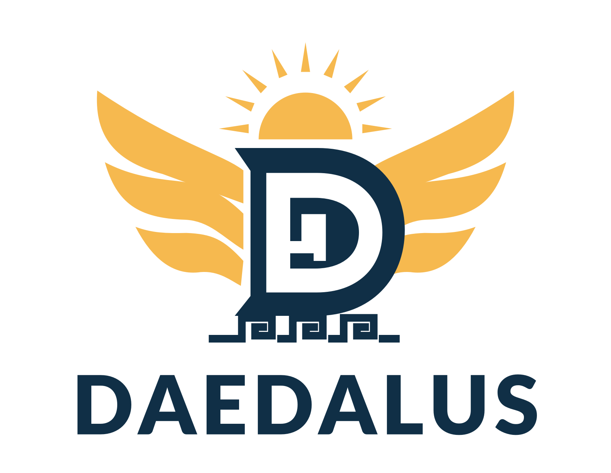
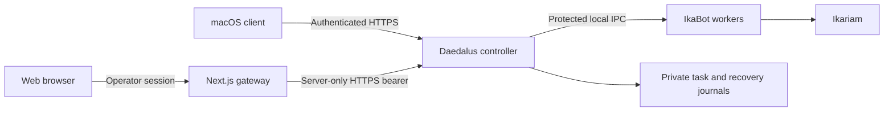

<div align="center">
  <picture>
    <source media="(prefers-color-scheme: dark)" srcset="assets/brand/png/daedalus-logo-dark-1600.png">
    <source media="(prefers-color-scheme: light)" srcset="assets/brand/png/daedalus-logo-light-1600.png">
    
  </picture>

  <p><strong>Daedalus for Ikariam — open-source macOS &amp; web control center for IkaBot</strong></p>

  <p>
    <a href="https://github.com/itshak/Daedalus/actions/workflows/ci.yml"></a>
    <a href="LICENSE"></a>
    
  </p>
</div>

**Daedalus is an open-source, multi-account management and automation suite for Ikariam, powered by the upstream [IkaBot](https://github.com/Ikabot-Collective/ikabot) engine.** It combines a native macOS application, a responsive web control center, and a self-hosted Python backend. Manage the same accounts and automations from either client, without running a separate bot for each interface.

> **Beta — v0.1.0 target.** The core system is implemented and in use, but this is prerelease software. Live game-changing workflows, recovery and physical Mac acceptance are still being validated. No stable-release certification or guarantee of game outcomes is implied. See [current status](docs/PROJECT-STATUS.md) and [known limitations](#beta-limitations).

[Download macOS](https://github.com/itshak/Daedalus/releases) · [Web control center](https://daedalus.tongrix.com) · [Installation and configuration](#getting-started) · [Report a bug](https://github.com/itshak/Daedalus/issues/new/choose)

## Features

| | What Daedalus offers |
| --- | --- |
| Multi-account workspace | One, selected or all accounts; verified session and worker status; account-bound operation reviews. |
| Warehouses | Actual city resource reports, island grouping, sortable/filterable web table, two-minute online cache, unsecured stock filters, printing and CSV/JSON/TXT exports. |
| Military | Read-only troop, fleet and ship-movement observations, with city-level unit counts and explicit unavailable states. |
| Automations | Native, typed editors for construction, recruitment, trade, transport, warehouse filling, research, faith, missions and monitoring; reviewed task start, stop, receipts and history. |
| Session recovery | Headless-first Mac Gameforge login, human-assisted browser fallback, protected session handoff and default-on delayed recovery for eligible monitored accounts. Safe jobs can resume after reattestation; uncertain effects remain held for review. |
| Shared backend | Authenticated REST API, host-local exclusive session ownership, persistent receipts and upstream-first IkaBot execution. |

## Choose your interface

### Native macOS app

A Fluent/PySide6 desktop app with direct HTTPS connection, macOS Keychain, native reporting, protected Gameforge login and task controls. Download the matching **DMG and SHA-256 checksum** from [GitHub Releases](https://github.com/itshak/Daedalus/releases). Preview DMGs are ad-hoc signed, not Apple-notarized; macOS may display a Gatekeeper warning. Follow the verified, user-initiated installation procedure in [macOS packaging](docs/MACOS-BUILD.md). Never disable system-wide Gatekeeper.

### Web control center

A responsive Next.js/React dashboard with English/Russian localization, saved navigation, resource filters, military inventory and reviewed automation workflows. The hosted [web control center](https://daedalus.tongrix.com) is private, invite-only and tied to the operator's backend. Self-hosters can deploy their own instance with Supabase Auth and the server-only controller gateway. Gameforge login and game credentials stay outside the web UI. See [web deployment and configuration](apps/web/README.md).

### Linux backend

The shared FastAPI controller owns account metadata, authenticates clients, coordinates compatible IkaBot workers, and maintains durable task/recovery records. Both clients use the same versioned API. Keep the backend and worker IPC private; expose only approved authenticated HTTPS ingress. Task control is an explicit backend capability and every mutation requires the existing reviewed/confirmed workflow.

## Getting started

**Try without a game account:** install the desktop preview and use its synthetic demo, or run the following from a clean Python 3.11+ virtual environment:

```bash
python -m pip install -e ".[server,desktop]"
export DAEDALUS_API_TOKEN="$(python -c 'import secrets; print(secrets.token_urlsafe(48))')"
daedalus serve --demo
# In another terminal:
daedalus-desktop
```

Connect the desktop to `http://127.0.0.1:8765` using the generated bearer. Synthetic mode displays invented account/city data and cannot dispatch real game tasks. See [demo walkthrough](docs/SYNTHETIC-DEMO.md).

**Configure a real installation:** follow [backend setup and migration](docs/MIGRATION.md), [secure HTTPS](docs/REMOTE-HTTPS.md), [saved-worker setup](docs/SAVED-WORKER.md), [persistent credentials](docs/PERSISTENT-CREDENTIALS.md) and [task control](docs/TASK-CONTROL.md). The default server is read-only; monitored task control and account editing have explicit prerequisites. Never point two independently running workers at the same account. Keep all private configuration outside Git. The Mac [quick start](docs/GUI-QUICKSTART.md) describes the exact-origin token and account sign-in workflows.

## Architecture



Daedalus uses the vendored public IkaBot 7.7.2 engine plus reviewed experimental upstream CLI/IPC work ([PR #499](https://github.com/Ikabot-Collective/ikabot/pull/499), #502 and #511). It is not an official stable upstream engine release. [ADR-006](openspec/adr/006-upstream-first-engine-reuse.md) requires upstream helpers, request builders and waiting mechanisms to be reused wherever possible. See [architecture](docs/ARCHITECTURE.md) and [engine provenance](engine/UPSTREAM.md).

## Beta limitations

- Full upstream option-level parity and live acceptance of all game-changing operations are not certified. See the [operation coverage matrix](docs/operation-coverage.json) and [beta operation scope and experimental limitations](docs/BETA-OPERATION-SCOPE.md).
- Recovery defaults on only for eligible monitored backends and enabled accounts; explicit disables/pauses, missing protected credentials, unresolved receipts and identity checks take precedence. Unsupported or ambiguous jobs are not automatically replayed. Confirmed fixed cargo dispatch is not proof of delivery. See [automatic recovery](docs/AUTOMATIC-RECOVERY.md).
- Real browser takeover, game-effect testing, full host reboot and physical Mac/VoiceOver acceptance remain separately tracked in [issue #60](https://github.com/itshak/Daedalus/issues/60). Use an isolated authorized account and do not assume a successful launch receipt proves game completion.
- Native macOS DMGs are preview packages; other desktop platforms can be developed from source, but equivalent native distributions are not certified.
- The web client never exposes arbitrary game IPC, raw automation JSON, Gameforge credentials or unaudited local administrative actions. Certain protected operations remain host-local.

## Development

```bash
python -m pip install -e ".[dev]"
python -m pytest -q tests
python -m pytest -q engine/ikabot/tests/ikabot
python -m ruff check src tests scripts
```

For desktop development install `.[dev,desktop]` and use native Cocoa on macOS or the supported offscreen Linux test environment. For web development use Node.js 22+ (CI uses 24):

```bash
cd apps/web
npm ci
npm run typecheck
npm run lint
npm test
npm run build
```

OpenSpec requirements live in [openspec/specs](openspec/specs/). See [engineering status](docs/PROJECT-STATUS.md), [remaining engineering proposal](openspec/changes/finish-v010-engineering/tasks.md) and [contribution guide](CONTRIBUTING.md). Public tests use synthetic fixtures only; never put live credentials or private game observations into CI.

## Repository layout

| Path | Purpose |
| --- | --- |
| `src/daedalus/` | Python API, account/session management, reviewed operations, recovery and CLI |
| `src/daedalus/desktop/` | Native macOS-focused Fluent interface |
| `apps/web/` | Next.js web UI, Supabase authentication and typed gateway |
| `engine/ikabot/` | Vendored IkaBot engine |
| `packaging/` | macOS build, installer and DMG tooling |
| `docs/`, `openspec/` | Operational guides, specifications and design history |

## Community and security

[Contributing](CONTRIBUTING.md) · [Code of Conduct](CODE_OF_CONDUCT.md) · [Security policy](SECURITY.md) · [Support](SUPPORT.md) · [Changelog](CHANGELOG.md). Report vulnerabilities privately; never post game credentials, cookies, bearer tokens, or private logs in public issues.

## License

Daedalus-original code is GPL-3.0-only ([LICENSE](LICENSE)). The vendored IkaBot engine retains its original MIT license ([engine license](engine/ikabot/LICENSE)). See [upstream provenance](engine/UPSTREAM.md). Daedalus is independently developed and is not affiliated with Gameforge or the upstream IkaBot maintainers.

Release engineering: [first beta preparation](docs/BETA-RELEASE.md).
